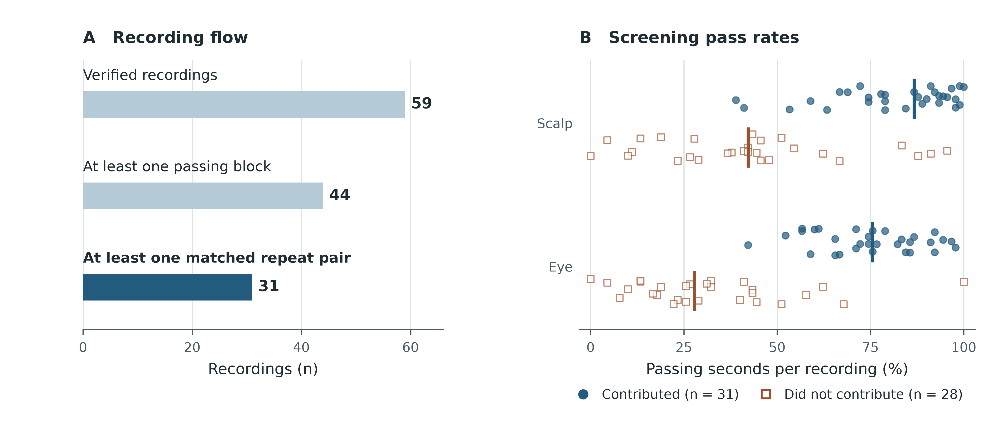
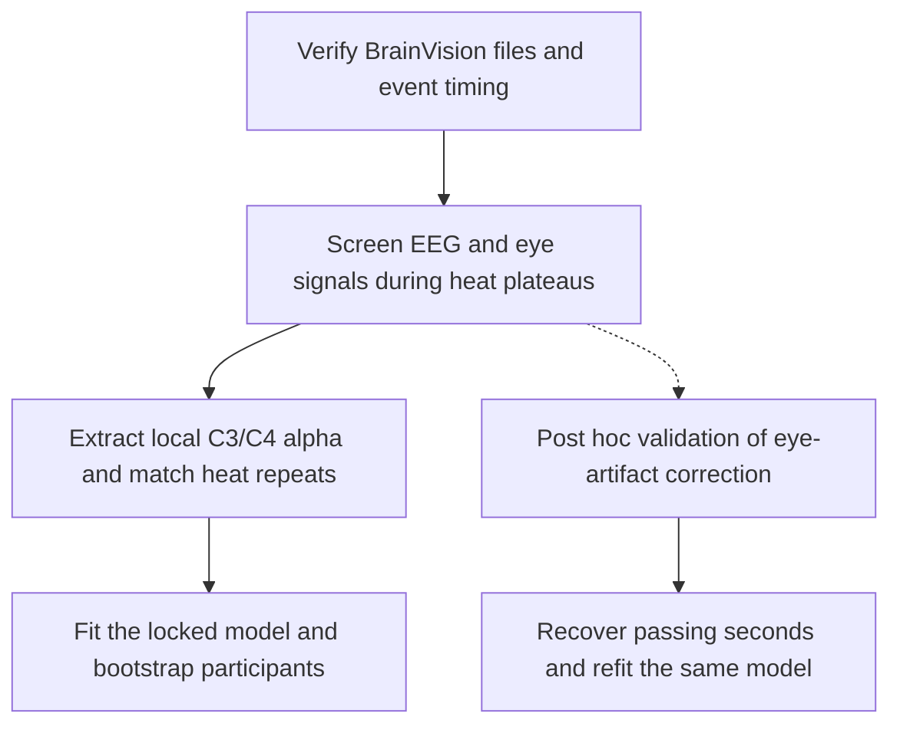
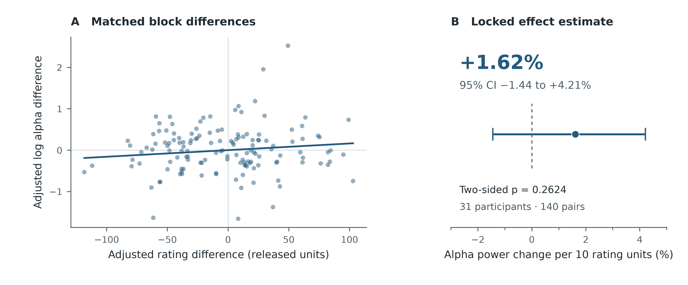
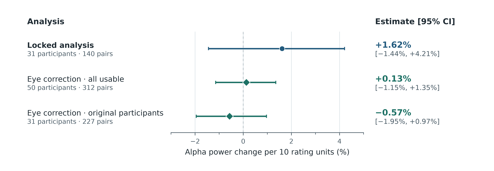

# Does central EEG alpha track reported heat pain?

**A reproducible within-person EEG analysis of temperature-matched heat repeats.** This project asks whether changes in reported pain are associated with changes in locally referenced C3/C4 alpha power (8–13 Hz) when programmed heat and measured temperature are similar. The workflow includes a locked confirmation analysis, an artifact-correction sensitivity check, and a local Streamlit viewer.

**Locked result.** Across 31 participants and 140 matched repeat pairs, the adjusted estimate was **+1.62% alpha power per 10 rating units** (95% participant-bootstrap CI **−1.44% to +4.21%**, two-sided **p = 0.2624**). The result was inconclusive. Eye-artifact correction recovered 19 recordings and yielded a tighter estimate centered near zero.

[Workflow](#workflow) · [Results](#results) · [Limitations](#limitations) · [Reproduce the project](docs/reproduce.md)

## Why match temperature?

The same heat can feel different across repeats. Matching delivered temperature within each person makes it possible to study variation in reported pain while holding the programmed heat level fixed. Prior tonic-heat studies motivate looking at alpha, but they differ in whether alpha more closely tracks delivered heat or reported pain. That motivated a two-sided test. [Peng et al. (2014)](https://journals.plos.org/plosone/article?id=10.1371/journal.pone.0091052) · [Nickel et al. (2017)](https://eprints.gla.ac.uk/134661/)

## Data and screening

The source is **OpenNeuro ds008349 v2.0.1**, a public dataset of EEG and physiological recordings during pain and aversive stimulation in pain-free adults. The analysis uses the rated contact-heat task, with continuous ratings and measured thermode temperature. A 15-person pilot established the workflow. The 59 separate confirmation recordings used the same EEG and thermode setup. The data release is **CC0**. [Versioned dataset](https://doi.org/10.18112/openneuro.ds008349.v2.0.1) · [Release metadata and license](https://raw.githubusercontent.com/OpenNeuroDatasets/ds008349/2.0.1/dataset_description.json)



*Figure 1. The locked screen retained 31 of 59 recordings. All 59 had temperature-eligible repeats before artifact screening. Of the 28 exclusions, 15 lacked a passing block and 13 had a passing block without a qualifying repeat pair.*

## Workflow



1. **Screen EEG.** Use one-second windows in the 25–35-second interval after each block marker. Earlier calibration windows nominate up to two scalp channels for omission. Retained seconds must pass scalp and eye-amplitude limits and have valid task signals and stable ratings.
2. **Extract alpha and match heat repeats.** Reference C3 and C4 to their local neighbors and estimate 8–13 Hz power with one-second Hann periodograms. Compare the same relative seconds across repeats at the same programmed level, with at least five common passing seconds within **0.10°C**.
3. **Estimate the association.** Regress the change in log alpha power on the rating change, adjusting for temperature differences and the repeat contrast within each programmed level. Give each participant equal total weight and resample whole participants for inference.

The [locked analysis plan](c3-c4-alpha-analysis-lock.json) records the full rules and participant IDs. The [executed notebook](confirmatory-c3-c4-alpha.ipynb) shows the analysis, screening comparison, and sensitivity checks.

## Results

### Locked test



*Figure 2. Each point represents a matched repeat pair. The effect and interval come from the participant-weighted model and 9,999 participant-bootstrap draws.*

The confidence interval allows both a decrease and an increase in alpha power. Prespecified sensitivity checks using 75 and 150 µV eye thresholds or an additional eye-signal covariate gave estimates from **+0.55% to +1.64%**, with all intervals spanning zero.

### Eye-artifact correction

Slow eye-signal regression recovered matched data for **19 of 28** originally excluded participants. In separate validation windows, median eye-aligned frontal EEG amplitude fell from **12.2 to 2.0 µV** across 56 recordings that passed correction validation. Seconds that had already passed kept their original alpha values.



*Figure 3. Effects are percent changes in alpha power per 10 released rating units, with 95% participant-bootstrap intervals.*

The full corrected sample used **50 participants and 312 comparisons**. Its estimate was **+0.13%** (95% CI **−1.15% to +1.35%**, two-sided **p = 0.7750**). Restricting the corrected analysis to the original 31 participants gave **−0.57%** (95% CI **−1.95% to +0.97%**). These post hoc checks show that the estimated association depended on the usable EEG windows, even when the participants stayed fixed.

[Figure captions](figures/captions.txt) · [Editable screening figure](figures/figure-1-eeg-screening.svg) · [Editable locked-result figure](figures/figure-2-locked-c3-c4-alpha.svg) · [Editable sensitivity figure](figures/figure-3-eye-correction-sensitivity.svg)

## Limitations

- **Selective retention.** The locked estimate represents the 31 participants with usable matched EEG. Contributors had cleaner signals and tended to report higher pain. The direction of any selection effect on the association remains uncertain.
- **Fixed stimulus sequence.** Repeat number, time in the session, and prior heat exposure are tied together. Matching temperature and adjusting for the repeat contrast address part of this problem, while adaptation and effects of rating the stimulus can persist.
- **Artifact correction.** Eye regression can remove signal shared between eye and scalp channels, including neural activity. The correction analysis used the same cohort and was conducted after the locked test.
- **Scope and precision.** The findings describe short windows during rated contact heat in a healthy sample. Pain specificity, clinical transfer, and generalization to other recording setups remain open questions. The locked interval also leaves room for modest effects in either direction.

## Reproduce or explore

MNE-Python reads the BrainVision recordings, NumPy, SciPy, and pandas handle screening and analysis, and Matplotlib renders the figures.

The [reproduction guide](docs/reproduce.md) covers the pinned Python 3.13 environment, checksum-verified downloads, the locked rerun, and figure generation. The full analysis uses the **8.28 GB confirmation subset**. For a quick look at the local viewer, use the **140 MB demo**. Run the following from the project folder.

```bash
python3.13 -m venv .venv
.venv/bin/python -m pip install -r requirements.txt
.venv/bin/python scripts/download_data.py --group demo
.venv/bin/python -m streamlit run app/app.py --server.address 127.0.0.1 --browser.gatherUsageStats false
```

Open the URL printed in the terminal. The viewer shows BrainVision traces, event markers, screening flags, and C3/C4 alpha power. [Viewer guide](app/README.md)

### Project files

- [Initial pilot](stage-1-pain-eeg-pilot.ipynb) and [expanded heat pilot](expanded-heat-eeg-pilot.ipynb) document the data and artifact checks that informed the hypothesis.
- [Confirmation notebook](confirmatory-c3-c4-alpha.ipynb) contains the locked test and post hoc analyses.
- [Scripts](scripts/) download the pinned dataset and rerun the analysis. [Figures](figures/) contains the exports, captions, and scripts to regenerate them.
- [Data manifests](data/manifests/) define the downloaded subsets. Raw EEG and local environment files are covered by the Git ignore rules.

The dataset is released under CC0. Licensing for project code and figures is a separate author decision.
