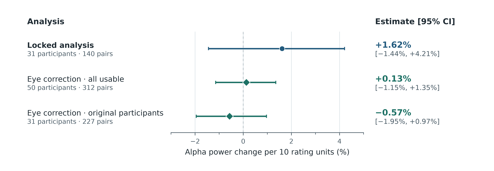

# Heat pain and central EEG alpha

## Research question

Does central EEG alpha power track changes in reported pain when delivered heat is nearly the same? I compared ratings and EEG within each participant across repeats at the same programmed level, using seconds whose measured temperatures differed by at most 0.10°C.

## What I built

I built a reproducible Python workflow that verifies versioned OpenNeuro downloads, reads BrainVision EEG with MNE-Python, screens scalp and eye signals, and estimates locally referenced C3/C4 alpha power (8–13 Hz). I also built a Streamlit viewer to inspect raw traces, event markers, screening decisions, and alpha power for individual recordings.

## What I validated

A 15-participant pilot informed the screening and analysis rules before the locked test on 59 separate recordings. I checked event and rating alignment, verified that the viewer reproduced the notebook's screening decisions and alpha values across all 59 recordings, and reran the analysis in a fresh pinned Python environment. The statistical model gave each participant equal total weight and resampled whole participants to account for repeated comparisons.

## What the results showed

**Locked test.** The screen retained 31 participants and 140 matched pairs. The estimated change was **+1.62% alpha power per 10 rating units** (95% CI −1.44% to +4.21%, two-sided p = 0.2624). The result was inconclusive.

**Post hoc sensitivity check.** Eye-artifact correction recovered matched data for 19 of 28 originally excluded participants. In separate validation windows, median eye-aligned frontal EEG amplitude fell from 12.2 to 2.0 µV across 56 recordings that passed correction validation. The expanded analysis used 50 participants and 312 pairs and estimated **+0.13%** per 10 rating units (95% CI −1.15% to +1.35%). The estimate was closer to zero and more precise in the same cohort.

Screening changed who contributed to the estimate, and the fixed heat sequence made it difficult to separate adaptation from other effects of repeat order. Those limits matter when interpreting the result outside the rated-heat task.

[Research abstract](abstract.md) · [Executed analysis notebook](../confirmatory-c3-c4-alpha.ipynb) · [Reproduction guide](reproduce.md) · [Viewer guide](../app/README.md)
